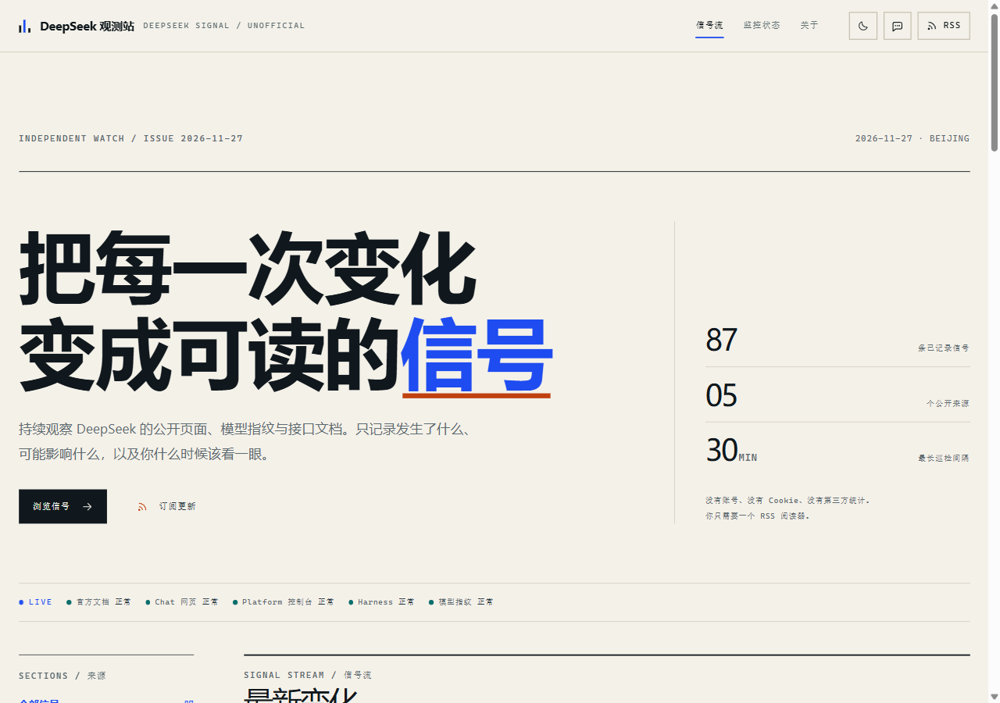

# DeepSeek Watch（非官方）

> **非官方项目**：与 DeepSeek 及其关联公司无隶属、授权或合作关系。DeepSeek 名称及相关商标归其权利人所有，本项目仅在描述监控对象时使用。所有内容以官方页面为准。

一个只读的 DeepSeek 变化观测站：定时巡检官方公开页面与版本信息，把变化整理成可读的中文信号，输出到网页、RSS 和可选的通知渠道。

**项目主页（参考部署）**：<https://deepseek-watch.pages.dev>

[](https://github.com/UNscientific-9/deepseek-watch/actions/workflows/ci.yml)
[](LICENSE)
[](https://deepseek-watch.pages.dev/feed.xml)



## 为什么做这个

DeepSeek 的文档、控制台、Harness 和模型能力更新很快，但官方没有一个集中的 changelog。这个项目把公开页面上的变化记录下来，按重要程度分级，再用网页和 RSS 提供持续跟进的方式。它只读公开信息，不需要账号，也不会抓取登录后的私密数据。

## 它监控什么

| 信号 | 数据来源 | 能发现什么 |
|---|---|---|
| 文档站变化 | 官方文档站与官网首页的公开页面、sitemap、静态资源 | 文档新增 / 改版 / 措辞变化 |
| 网页变化 | Chat / Platform / Harness 的公开前端资源与页面结构 | 页面改版、入口调整、功能公告 |
| DSH 软件更新 | GitHub release、master 提交、npm 包、桌面端更新清单 | 新版本发布、发版前预告、安装包更新 |
| 模型目录 | 公开的 `GET /models` 接口 | 模型上架 / 下架 / 别名变化 |
| 价格页版本 | 官方价格页上的模型版本行 | 官方更换底层模型 |
| API 指纹（可选） | 配置 API Key 后发最小请求读取 `system_fingerprint` | 后端部署 / 检查点变化 |
| 余额（可选） | `/user/balance` 免费接口 | 账户余额异常消耗 |

所有抓取只访问公开页面或官方公开接口，不需要登录，不执行页面脚本，不保存访问者信息。

## 组成

| 目录 | 作用 |
|---|---|
| `docwatch/` | 文档站与官网首页巡检：抓取 → 规则定级 → 可选模型解读 → 邮件 |
| `webwatch/` | 网页 / DSH 更新 / 模型目录 / 价格页 / API 指纹巡检 |
| `watchsite/` | 汇总 docwatch / webwatch 事件，推送到站点；可选邮件与 QQ 播报 |
| `watchcloud/` | Cloudflare Pages + Functions + D1 只读站点：首页、详情、筛选、RSS、sitemap |
| `deploy/` | Linux systemd 单元示例与部署说明 |
| `tools/` | 前端资源镜像、差异审计等维护工具 |

数据流：

```text
docwatch / webwatch 采集 → 事件 JSON / 状态
        ↓
watchsite 读取并按 id 去重 → 分批 POST /internal/ingest
        ↓
Cloudflare Functions 校验 → D1 upsert → 网页 / RSS / sitemap
```

## 快速开始

### 环境

- Python 3.12+（`docwatch`、`webwatch`、`watchsite` 只用标准库，无需安装依赖）
- Node.js 22+（仅 `watchcloud` 需要）

### 本地跑一次巡检（dry-run）

```bash
# 只抓取并打印，不写状态、不发通知
python -m webwatch.run --dry-run --no-api

# 文档站巡检（需要指定临时数据目录）
python -m docwatch.run --dry-run --data-dir .tmp/docwatch-dryrun

# 同步 / 推送器只打印，不发网络请求
python -m watchsite.push --dry-run
```

`--dry-run` 仍会真实联网抓取公开页面，但不会写状态、不会发邮件、不会调用模型。

### 本地跑站点

```bash
cd watchcloud
npm install
npm run db:init:local
npm run dev:local
# 打开 http://127.0.0.1:8788
```

## 配置

所有敏感配置都通过环境变量读取，仓库内不保存任何真实凭据。常用变量：

| 变量 | 用途 |
|---|---|
| `DEEPSEEK_API_KEY` | 可选的 API 指纹 / 余额探测；不配置则跳过 |
| `SMTP_USER` / `SMTP_PASS` / `SMTP_HOST` | 邮件通知 |
| `WEBWATCH_LLM_URL` / `WEBWATCH_LLM_MODEL` | 可选的 OpenAI 兼容网关，用于生成更新说明 |
| `INGEST_TOKEN` | 站点写入接口的鉴权 token |
| `SITE_URL` | 站点公开地址 |
| `QQ_NOTIFY_*` | 可选的 QQ 播报（NapCat / OneBot v11） |

完整说明见各目录 README 与 `docs/ARCHITECTURE.md`。

## 部署

- 站点：Cloudflare Pages + D1，见 [docs/DEPLOY.md](docs/DEPLOY.md)。
- 采集器：Linux systemd timer，见 [deploy/README.md](deploy/README.md)。

## 社区

- QQ 交流群（公开）：`721260245`。仅用于项目使用讨论，不提供 DeepSeek 官方支持。
- 误报 / 漏报 / 功能建议优先开 GitHub Issue，方便追踪和复现。

## 安全

- 本仓库不包含任何真实密钥、token、密码或私钥。
- 请不要提交 `.env`、`.env.*`、`.dev.vars`、`apikey.env`、`*.key`、`*.pem` 或任何本地凭据文件。
- 发现安全问题请按 [SECURITY.md](SECURITY.md) 私下报告，不要公开开 issue。

## 许可

代码以 [MIT License](LICENSE) 发布。第三方组件、商标与示例内容的说明见 [THIRD-PARTY-NOTICES.md](THIRD-PARTY-NOTICES.md)。

